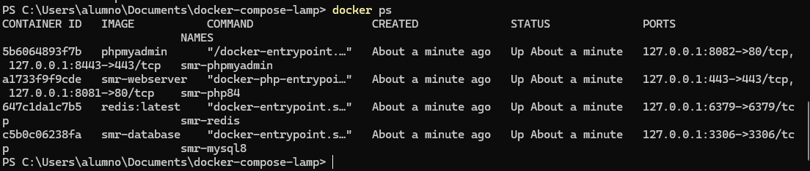
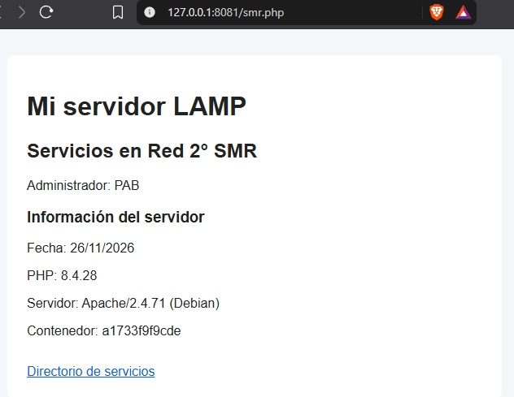
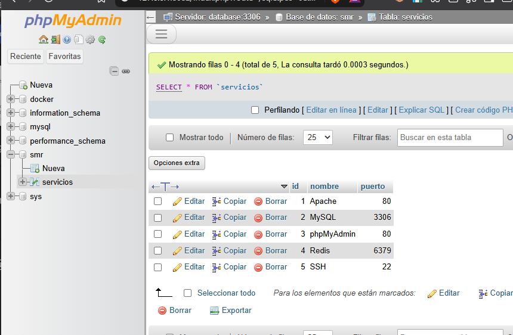
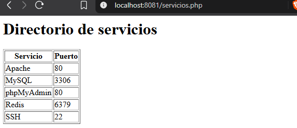
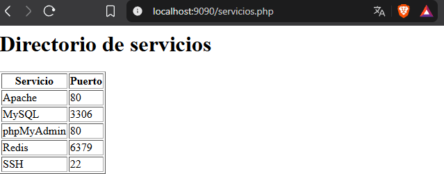

# Práctica: Despliegue y administración de un servidor LAMP con Docker Compose

**Administrador:** PAB  
**Módulo:** Servicios en Red — 2.º SMR  

## Descripción

Despliegue y administración de un entorno LAMP mediante Docker Compose en una red interna aislada, exponiendo los servicios web y de administración hacia el equipo anfitrión en `127.0.0.1` y persistiendo los datos en carpetas y volúmenes del proyecto.

## Estructura del proyecto

| Elemento | Función |
| :--- | :--- |
| `docker-compose.yml` | Define los servicios (`webserver`, `database`, `phpmyadmin`, `redis`), redes, puertos y volúmenes |
| `sample.env` | Plantilla de variables de entorno de ejemplo (puertos, versiones, base de datos y credenciales) |
| `www/` | Directorio raíz de la web servido por Apache/PHP (incluye `smr.php` y `servicios.php`) |
| `bin/` | Archivos de construcción (`Dockerfile`) para compilar las imágenes de PHP y base de datos |
| `config/` | Configuraciones de Apache, PHP, MySQL/MariaDB, SSL o scripts de inicio (`initdb`) |
| `data/` | Almacenamiento persistente de datos de la base de datos en el equipo |
| `logs/` | Registros (`logs`) generados por Apache, PHP/Xdebug y la base de datos |
| `.gitignore` | Indica a Git qué archivos o carpetas ignorar (como `.env` o datos internos) |

## Servicios desplegados

| Servicio | Función | Puerto interno | Puerto externo |
| :--- | :--- | :--- | :--- |
| Apache/PHP | Servidor web y ejecución de scripts PHP | `80` (y `443` si aplica) | `8081` (`127.0.0.1:8081`) |
| MySQL | Base de datos relacional (`smr`) | `3306` | `3306` (`127.0.0.1:3306`) |
| phpMyAdmin | Interfaz web para administrar MySQL | `80` | `8082` (`127.0.0.1:8082`) |
| Redis | Almacén clave-valor en memoria | `6379` | `6379` (`127.0.0.1:6379`) |

## Instrucciones de despliegue

1. Hacer fork del repositorio original en GitHub, clonarlo y abrirlo en Visual Studio Code.
2. Copiar `sample.env` a `.env` y configurar `COMPOSE_PROJECT_NAME=smr`, `HOST_MACHINE_UNSECURE_HOST_PORT=8081`, `HOST_MACHINE_PMA_PORT=8082`, `MYSQL_DATABASE=smr` y las credenciales de laboratorio.
3. En `docker-compose.yml`, anteponer `127.0.0.1:` a los puertos publicados y pasar `MYSQL_USER`, `MYSQL_PASSWORD` y `MYSQL_DATABASE` al entorno de `webserver`.
4. Comprobar la configuración con `docker compose config --quiet` y verificar que `.env` está ignorado con `git check-ignore .env`.
5. Levantar los servicios con `docker compose up -d` y comprobar su estado con `docker compose ps`.
6. Crear `www/smr.php` y `www/servicios.php`, crear la tabla `servicios` con cinco registros en la base de datos `smr` desde phpMyAdmin y exportar el respaldo a `sql/smr.sql`.

## Cuestiones y respuestas

### Comprensión de la infraestructura

* **Diferencia entre imagen y contenedor:** Una imagen es la plantilla base inmutable con el sistema y software empaquetados; un contenedor es la instancia en ejecución creada a partir de esa imagen con su propia capa de escritura y estado.
* **Diferencia entre puerto interno y externo:** El puerto interno es el puerto en el que escucha el servicio dentro del contenedor; el puerto externo es el puerto del equipo anfitrión al que se conecta el navegador o cliente.
* **Por qué Apache funciona sin instalarlo directamente en Windows:** Docker ejecuta los contenedores en su motor/entorno Linux (WSL2/VM), de modo que Apache se ejecuta aislado dentro del contenedor sin instalarse en el sistema Windows.

### Comunicación entre contenedores

* **¿Por qué `database` y no `localhost`?** Dentro del contenedor `webserver`, `localhost` apunta al propio contenedor web, no al de MySQL. Docker Compose resuelve el nombre de servicio `database` a través de su DNS interno en la red del proyecto.
* **¿Qué contenedores se comunican?** `webserver` (Apache/PHP) actúa como cliente y se conecta a `database` (MySQL) por el puerto `3306` (`phpmyadmin` también conecta con `database`).
* **¿Por qué usar variables de entorno para las credenciales?** Evita dejar contraseñas fijas en el código PHP y permite cambiar valores por entorno sin tocar `servicios.php`.
* **¿Qué ocurre si MySQL deja de funcionar?** La conexión `mysqli` desde `servicios.php` falla y la página no puede consultar ni mostrar los registros de la tabla `servicios`.

### Ciclo de vida y persistencia

* **Diferencia entre `stop` y `down`:** `docker compose stop` detiene los contenedores pero los conserva creados; `docker compose down` detiene y elimina los contenedores y la red del proyecto (sin borrar volúmenes a menos que se use `-v`).
* **¿Se conservan los archivos PHP y los registros MySQL?** Sí, siempre que no se use `down -v`, ya que `www/` está en el directorio del proyecto y los datos de MySQL se mantienen en almacenamiento persistente.
* **¿Dónde se almacenan los datos?** Los archivos web están en `www/` en el host y los datos de la base de datos en el volumen/carpeta persistente asociada al servicio de base de datos (`data/mysql`).
* **¿Qué función cumple `volumes` en `docker-compose.yml`?** Vincula carpetas del host o volúmenes gestionados por Docker con rutas dentro del contenedor para conservar datos y sincronizar archivos como `www/`.

## Evidencias de funcionamiento

### 1. Contenedores activos en Docker Desktop

### 2. Página de información del servidor (`smr.php`)

### 3. Registros de la base de datos en phpMyAdmin

### 4. Directorio de servicios consultado desde PHP (`servicios.php`)

## Reto adicional (puerto 9090)

Se modificó `HOST_MACHINE_UNSECURE_HOST_PORT=9090` en `.env`, se aplicó el cambio con `docker compose up -d` y se verificó el acceso a `http://localhost:9090/smr.php` y `http://localhost:9090/servicios.php`.